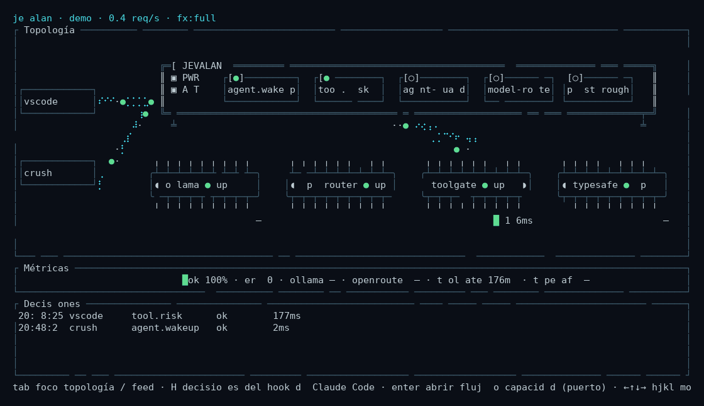

# jevalan

A local decision hub. Agents (Claude Code, Crush, scripts…) ask it whether to do
something; jevalan decides — or has a specialist decide — and returns a typed answer.
**It never performs the effect**: that stays with whoever asked.

Release candidate: `0.1.0-alpha.1` (unpublished). See the [release policy](docs/releases.md) for
versioning and platform builds.

The full design, with diagrams, is in [`docs/architecture.md`](docs/architecture.md).

## Status

The repository is a single Rust workspace: `src/crates/` and the root `Cargo.toml`.
The live view is the terminal UI; there is no web UI.

## Quick start

A deterministic fake feed — no daemon, no capabilities involved, so it works today:

```bash
cargo run -p jevalan -- tui --fake
```

The richer demo — embedded daemon, three mock backends, simulated traffic — is
`cargo run -p jevalan -- tui --demo`. Its manifests use v2, like the rest of the repository.
Select a backend chip in the topology (`n` / `N`) and press `x` to knock it over live:
it starts answering `500`, the chip goes `down` after three failed responses, and flows
take their `error` port. Press `x` again to bring it back. Everything dies when the TUI
exits.

Animated dashboard: simulated requests move across the topology. Frames come from
Ratatui's current renderer using TestBackend, with approximate colors; this is not a
screen recording.



Plain `cargo run -p jevalan -- tui` (no `--demo`) instead attaches to a daemon if one
answers, or starts one against real backends — and sends no traffic of its own.

More detail, including the `--fake` generator and the sandbox caveats:
[`docs/local-development.md`](docs/local-development.md).

## Command surface

| Command | What it is |
|---|---|
| `jevalan tui [--demo\|--fake]` | Terminal dashboard: topology, metrics, decision feed, trace view |
| `jevalan edit <FICHERO> [--url] [--token] [--no-events]` | Flow editor: opens a `config/flows/*.yaml` as a draft and never publishes it |
| `jevalan serve [--config]` | The daemon: System One proxy, decision flows, event bus |
| `jevalan hook claude-code [--mode shadow\|enforce]` | Claude Code `PreToolUse` hook; asks for `tool.risk` |
| `jevalan hook crush [--mode shadow|enforce]` | Crush command hook; native output format |
| `jevalan hook run --client <name> --dialect <claude|crush>` | Generic hook adapter |
| `jevalan lab {check,offline,record,live}` | Fixture lab: regression offline, measurement live |
| `jevalan shadow {report,fixtures}` | Reports over `shadow.jsonl`, and fixtures mined from it |

## The flow editor

```powershell
cargo run -p jevalan -- edit config/flows/tool-risk-local.yaml
```

It opens the flow as a **draft**: nothing is published, the daemon's registry is untouched, and
saving writes the YAML **by patches**, so comments, order and line endings survive. The draft is
validated against the daemon when one answers, and against the same local parser
(`jevalan_flow::parse`) when none does — in that second case the band says the backends could not be
checked, and everything else (the CEL, the ports, the cycles, the models) still is. A draft that
does not validate is **never written to disk**, not even with `g` (save aside).

Keys: `tab` moves between graph, inspector and band; arrows (or `hjkl`) move the selection; `e`
edits the selected field; `a` adds a node, `d` deletes it and `c` rewires a port, each with its
one-line menu; `s` saves and `enter` confirms the destructive actions; `q` quits with a warning if
there are unsaved changes.

The full key table, and a manual script that works on a **copy**, are in
[`docs/local-development.md`](docs/local-development.md) — worth following, because
`config/flows/tool-risk-local.yaml` decides for real: the Claude Code hook asks it.

## Repository layout

```
src/                 Rust workspace (crates/) and TypeScript SDK (sdk-ts/)
config/              flows, capabilities, signals, schemas and lab fixtures
docs/                architecture, guides and the presentation site (site/)
tools/scripts/       helper scripts (installing the binary)
```

## Documentation

| Document | Contents |
|---|---|
| [`docs/architecture.md`](docs/architecture.md) | How the pieces fit, with diagrams |
| [`docs/local-development.md`](docs/local-development.md) | Running it and configuration |
| [`docs/claude-code-hook-install.md`](docs/claude-code-hook-install.md) | Installing the Claude Code hook |
| [`docs/crush-hook-install.md`](docs/crush-hook-install.md) | Installing the Crush hook |
| [`docs/releases.md`](docs/releases.md) | Alpha policy and GitHub release builds |
| [Contributing](CONTRIBUTING.md) | Development setup and checks for pull requests |
| [Security policy](SECURITY.md) | Private vulnerability reports |
| [`docs/site/`](docs/site/) | Presentation and user guide (Spanish, English, Chinese) |

## Trademarks and affiliation

Jevalan is an independent project. It is not affiliated with, endorsed by, or sponsored by Anthropic (Claude Code), Charm (Crush), OpenRouter, TypeSafe, or any other company named in this repository. Those names are used only to describe the integrations jevalan can talk to, and belong to their respective owners.

## License

Jevalan is available under either the [MIT License](LICENSE-MIT) or the [Apache License, Version 2.0](LICENSE-APACHE), at your option.

The licenses of the third-party libraries linked into the binaries are in [`THIRD_PARTY_LICENSES.txt`](THIRD_PARTY_LICENSES.txt), generated with `cargo about generate about.hbs`. Release archives include it.
