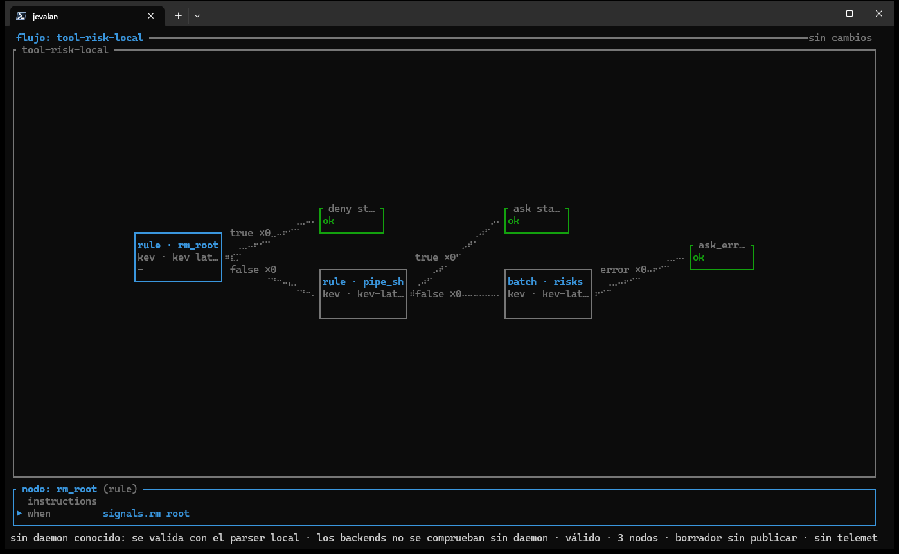

Un **flujo** es un pequeño grafo de decisión escrito en YAML. Empieza en un nodo, sigue los puertos de nodo en nodo y termina en una **salida** que lleva un `outcome` y, si quieres, `data`. Los flujos son ficheros normales en `flows_dir` (por defecto `./config/flows`), así que puedes revisarlos en una pull request y llevarlos en control de versiones.

## Anatomía de un flujo

```yaml
description: "Enruta un ticket de soporte"   # se ve en la TUI y en GET /v1/flows
defaults: { backend: ollama, model: nimble }    # lo usan los nodos que preguntan a un modelo
start: urgent                                   # el primer nodo
nodes:
  urgent:
    type: rule                                  # sin modelo
    when: 'input.priority == "high"'            # CEL sobre la petición
    out: { "true": page, "false": billing }     # puerto -> siguiente nodo o salida
  billing:
    type: rule
    when: 'input.topic == "billing"'
    out: { "true": finance, "false": queue }
outputs:
  page:    { outcome: ok, data: { team: oncall,  ticket: "$input/id" } }
  finance: { outcome: ok, data: { team: finance, ticket: "$input/id" } }
  queue:   { outcome: ok, data: { team: support, ticket: "$input/id" } }
```

Guárdalo como `config/flows/ticket-triage.yaml` y el daemon lo carga sin reiniciar. Pídele una decisión:

```sh
curl -s http://127.0.0.1:8080/v1/decide/ticket-triage \
  -H 'Content-Type: application/json' \
  -d '{"state":{"id":"T-42","priority":"high","topic":"login"}}'
```

```json
{"data":{"team":"oncall","ticket":"T-42"},"flow":"ticket-triage","outcome":"ok","path":[{"answer":true,"backend":"-","confidence":1.0,"duration_ms":0,"model":"-","node":"urgent","port":"true"}],"trace_id":"18e2ca4a6312005c0002"}
```

El `state` de la petición es lo que tus expresiones ven como `input`. La respuesta trae el `outcome`, el `data` de la salida y el `path` que recorrió el flujo, una entrada por nodo, así que siempre puedes ver por qué una decisión salió como salió.

## Tipos de nodo

| Tipo | Qué hace | Llama a un modelo |
|---|---|---|
| `rule` | Evalúa una expresión [CEL](https://cel.dev) sobre `input`. Puertos: `true` y `false`. | No |
| `noul` | Hace una pregunta de sí o no y obtiene una probabilidad. Se parte con un `threshold`, o se asignan rangos de probabilidad a puertos. | Sí |
| `choice` | Pide al modelo que elija una etiqueta de `criteria`. Cada etiqueta es un puerto. | Sí |
| `score` | Pide una puntuación sobre una lista ordenada de `criteria`. Los puertos son rangos numéricos como `"0..1.5"`. | Sí |
| `batch` | Hace varias preguntas en **una** llamada al backend y enruta según todas las respuestas. | Sí (una llamada) |

Los rangos numéricos incluyen su límite inferior: una puntuación `score` de `1.5` toma el puerto `"1.5..3"`.

Los nodos que preguntan a un modelo llevan `instructions` (la pregunta) y `criteria`, y heredan `backend` y `model` de `defaults` salvo que nombren los suyos.

Además de tus puertos, un nodo con modelo puede usar dos especiales:

- `error`: se toma cuando el backend falla o agota el plazo. Sin él, un nodo que falla termina la petición con `502`.
- `low-confidence`: se toma cuando la confianza del modelo queda por debajo de `min_confidence`.

Un flujo que enruta el trabajo a un modelo según la dificultad, tomado de `config/flows/model-route.yaml` del repositorio, usa todo esto:

```yaml
nodes:
  tier:
    type: score
    instructions: "¿Cuánta dificultad tiene la tarea?"
    criteria: ["trivial", "sencilla", "media", "difícil", "muy difícil"]
    out: { "0..1.5": small, "1.5..3": risky, "3..4": large, error: medium, low-confidence: medium }
  risky:
    type: noul
    instructions: "¿La tarea toca seguridad, datos de producción o dinero?"
    out: { "true": large, "false": medium }
outputs:
  small:  { outcome: route, data: { model: haiku, effort: low } }
  medium: { outcome: route, data: { model: sonnet, effort: medium } }
  large:  { outcome: route, data: { model: opus, effort: high } }
```

## Salidas y referencias

Una salida tiene un `outcome` (la etiqueta que quieras: `ok`, `allow`, `deny`, `route`…) y un objeto `data` opcional que se devuelve a quien llamó. Dentro de `data` puedes copiar valores con referencias:

| Referencia | Valor |
|---|---|
| `"$input/id"` | El campo `id` del `state` de la petición. |
| `"$answer/<nodo>"` | La respuesta de un nodo con modelo. |
| `"$answer/<nodo>/<pregunta>"` | Una respuesta de un nodo `batch`. |

## Batch: varias preguntas, una llamada

Un nodo `batch` evita encadenar varias llamadas y te deja decidir con todas las respuestas a la vez. Las respuestas están en `answers.<nodo>.<pregunta>`:

```yaml
risks:
  type: batch
  questions:
    destructive:  { type: noul, instructions: "…", criteria: { "true": "…", "false": "…" } }
    exfiltration: { type: noul, instructions: "…", criteria: { "true": "…", "false": "…" } }
  route:                                   # en orden: gana el primer `when` verdadero
    - { when: "answers.risks.destructive >= 0.85", to: deny }
    - { when: "answers.risks.destructive >= 0.55", to: ask }
  else: allow                              # si ningún `when` casa
  out: { error: ask_error }                # opcional: adónde va un fallo del backend
```

## Señales reutilizables

Cuando varios flujos hacen la misma pregunta, declárala una vez como **señal** en `config/signals/<nombre>.yaml` y nómbrala desde el flujo. Una señal es el cuerpo de un nodo sin nada cableado: `type`, `instructions`, `criteria` o `when`, pero nunca `out`, `backend` ni `model`. El nombre del fichero es el nombre de la señal.

- Una señal **heurística** (`type: rule`) es CEL solo sobre `input`. Cualquier `when` la lee como `signals.<nombre>`.
- Una señal **aprendida** (`noul`, `choice`, `score`) es una pregunta. Un `batch` la pide con `signals: [nombre, …]`.

El `config/flows/tool-risk-local.yaml` que viene de serie combina ambas: dos reglas fijas que corren primero y luego cuatro preguntas al modelo en una sola llamada.

```yaml
# config/signals/rm_root.yaml — una heurística
type: rule
when: 'has(input.tool_input.command) && input.tool_input.command.matches(r"rm\s+-[a-zA-Z]*[rf][a-zA-Z]*\s+(/|~|\$HOME)(\s|$)")'
```

```yaml
# en el flujo
risks:
  type: batch
  signals: [destructive, exfiltration, privilege, secret_exposure]
  route:
    - { when: 'answers.risks.exists(k, answers.risks[k] >= 0.85)', to: deny }
    - { when: 'answers.risks.exists(k, answers.risks[k] >= 0.55)', to: ask }
  else: allow
```

Una heurística que falla manda su nodo al puerto `error`; nunca se lee como `false`.

## Editar flujos con seguridad

- **Recarga en caliente.** El daemon vigila `flows_dir` y `signals_dir`. Guardar un fichero válido sustituye el flujo; un fichero inválido conserva la versión anterior y aparece con su motivo en `GET /v1/flows`.
- **Valida antes de guardar.** Manda el YAML a `POST /v1/flows/validate`, o ejecuta un borrador una vez con `POST /v1/flows/draft/run`. Ninguno publica nada. Mira la [API HTTP](/api/).
- **Usa el editor visual.** `jevalan edit config/flows/<flujo>.yaml` abre un borrador en la terminal y escribe los cambios como parches, así que los comentarios y el orden sobreviven. Nunca escribe un borrador que no valide.
- **Ojo con los flujos en producción.** `config/flows/tool-risk-local.yaml` y `config/signals/` deciden de verdad cuando el hook de Claude Code está instalado. Practica sobre una copia.


