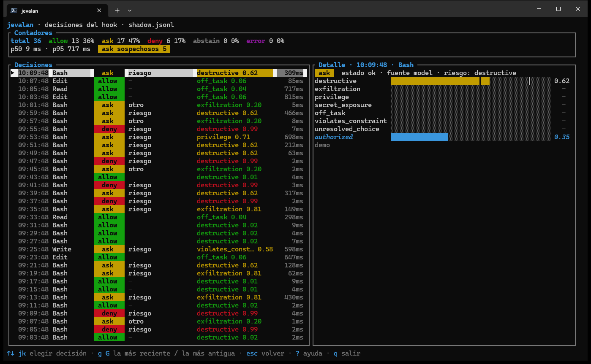

Jevalan 自带 hook 适配器。hook 是客户端在**每次工具调用之前**运行的小程序：它把这次调用发送到本地能力中心，请求 `tool.risk` 能力，并把答案转换成客户端期望的格式。Jevalan 不会执行任何操作；最终决定权始终在客户端手里。

## Shadow 与 enforce

每个 hook 都运行在两种模式之一，用 `--mode` 选择：

| | `shadow`（默认） | `enforce` |
|---|---|---|
| 向客户端输出什么 | 什么都不输出，并且始终以 0 退出 | 当判定比客户端自身更严格时，输出一个判定 |
| 对会话的影响 | 无：客户端与之前完全一样 | `deny` 会阻止，`ask` 会让客户端询问你 |
| 记录决策 | 是，写入 `shadow.jsonl` | 是 |

在 `enforce` 下，hook 只能**收紧**权限，永远不能放宽：

| 判定 | hook 的行为 |
|---|---|
| `deny` | 阻止该工具，并显示原因。 |
| `ask` | 让客户端询问你。 |
| `allow` | 保持沉默：客户端自身的权限仍然生效。 |
| 没有答案（无守护进程、弃权、错误、超时、输入有误） | 返回 `ask`，绝不盲目 `allow`。 |

该表格针对 Claude Code。Crush 无法通过 hook 发起询问，因此在 Crush 中只有 `deny` 会输出内容：`ask` 和“无答复”保持沉默，由 Crush 自己的权限来决定。

先从 `shadow` 开始，阅读几天报告，然后再切换到 `enforce`。

## Claude Code

把 hook 添加到 `~/.claude/settings.json`，使用二进制文件副本的**绝对路径**（切勿指向 `target/`，这样 `cargo clean` 就不会破坏你的会话）：

```json
{
  "hooks": {
    "PreToolUse": [
      {
        "matcher": "*",
        "hooks": [
          { "type": "command", "command": "/path/to/jevalan hook claude-code --mode shadow" }
        ]
      }
    ]
  }
}
```

用 `jevalan serve` 启动守护进程。它开始监听后，会在 Windows 的 `%LOCALAPPDATA%/jevalan` 或其他系统的 `$HOME/.jevalan` 中写入一个发现文件（`daemon.json`，包含地址和令牌），hook 可以从任何文件夹找到它。如果守护进程没有运行，hook 找不到该文件，甚至不会尝试连接。

完整指南（包括如何在 Windows 上更新已安装的二进制文件）在仓库中：[安装 Claude Code hook](https://github.com/jevalan/jevalan/blob/main/docs/claude-code-hook-install.md)。

## Crush

Crush 的 hook 与 Claude Code 的兼容。在你的 `crushrc` 中添加一行：

```sh
hook add PreToolUse --name jevalan --matcher '^(bash|edit|write|multiedit)$' --command '"$LOCALAPPDATA/jevalan/bin/jevalan.exe" hook run --client crush --dialect crush --mode shadow' --timeout 8
```

`jevalan hook run --client <name> --dialect <claude|crush>` 是通用的：支持另一个客户端只需要改参数，不需要改代码。Crush 只区分 `allow` 和 `deny`，所以在 `enforce` 下它要么阻止，要么交给它自己的权限来决定。参见[安装 Crush hook](https://github.com/jevalan/jevalan/blob/main/docs/crush-hook-install.md)。

## 隐私：使用本地模型

hook 是**全局**的：你机器上每个项目的每次工具调用，包括客户仓库和 `.env` 文件，都会发送到守护进程，守护进程再把它交给为 `tool.risk` 提供服务的一方。影子日志中的脱敏只保护本地文件；**守护进程转发出去的内容会原样发出**。

因此，在出站防护存在之前：

- 用**本地**模型为 `tool.risk` 提供服务，就像 `config/flows/tool-risk-local.yaml` 所做的那样。没有任何内容离开你的机器。
- **不要**把 hook 的守护进程指向云端后端或第三方专家。

所需的防护包括：当工具涉及敏感路径（`.env*`、`*.pem`、`id_rsa*`、kubeconfig……）时不进行查询，同时对出站输入脱敏，清理对话记录，只允许列表中的文件夹，并用你自己的仓库验证脱敏规则。

## hook 记录什么

每个决策都会追加到同一数据目录中的 `shadow.jsonl`，其中已知格式的密钥（`sk-…`、`ghp_…`、`AKIA…`、`Bearer …`、`key=value`）会被替换为 `[REDACTED]`。该文件留在你的机器上，而且其中仍然保存着命令，所以不要上传它。

把它变成可读的内容，再变成测试：

```sh
# 一份 Markdown 报告：判定、出现 ask 的原因、概率、延迟
jevalan shadow report --since 2026-10-01 --out report.md

# 同上，并附上每个示例脱敏后的摘录（仅限本地使用）
jevalan shadow report --with-inputs

# 把真实决策转成实验室 fixture，风险最高的优先
jevalan shadow fixtures --lab-dir lab-fixtures-batch --max 20
```

默认情况下，报告不包含工具输入，所以你可以发布它。这些 fixture 会供给[实验室](/zh-cn/laboratorio/)，让你的测试集随着真实发生的情况而增长。

在终端界面中按 `H` 可以实时查看决策：带 p50 和 p95 延迟的计数器、最近的调用，以及每个问题的概率条（在 0.55 和 0.85 阈值处有刻度）。它在本地读取该文件，从不显示输入，所以截图是安全的。



## 超越 hook

如果你的客户端支持 MCP，[`jevalan mcp`](/zh-cn/servidor-mcp/) 会把这些能力暴露为工具，无需编写适配器。

## 卸载

从 `~/.claude/settings.json` 的 `PreToolUse` 中删除 `jevalan` 条目（或在 `/hooks` 中禁用它），或在 Crush 中运行 `hook remove PreToolUse --name jevalan`。
